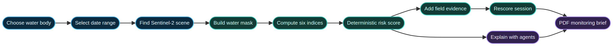
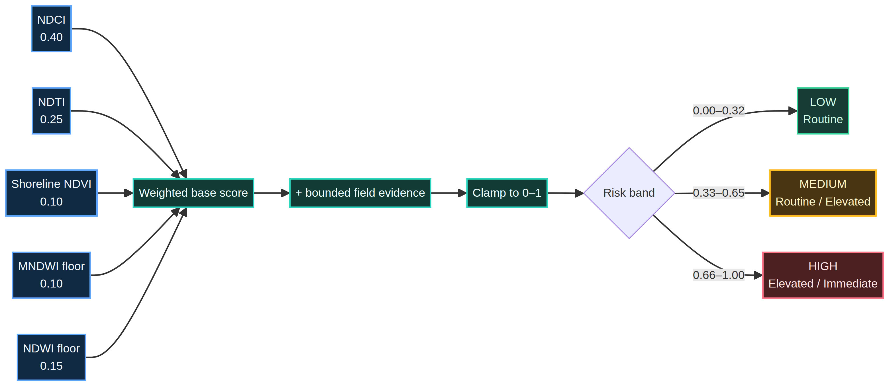
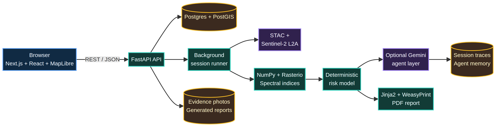

<div align="center">
  

  <h2>See water differently.</h2>

  <p>
    AquaLens is a freshwater monitoring platform that combines satellite imagery,
    field observations, transparent risk scoring, and explainable AI.
  </p>

  <p>
    <a href="https://frontend-eight-gamma-82.vercel.app">Open the live app</a> ·
    <a href="https://aqua-lens-backend.onrender.com/docs">Explore the API</a> ·
    <a href="docs/user_manual.md">Read the user guide</a>
  </p>
</div>

<br />

> **Important:** AquaLens provides environmental guidance for prioritising follow-up investigation. It is not a water-safety certification, toxin detector, laboratory test, or replacement for professional judgment.

<table>
  <tr>
    <td><strong>6</strong><br />spectral indices</td>
    <td><strong>3</strong><br />risk bands</td>
    <td><strong>5</strong><br />agent stages</td>
    <td><strong>1</strong><br />traceable report</td>
  </tr>
</table>

## What is AquaLens?

AquaLens helps a monitoring team understand what may be happening in a lake, river, reservoir, or other freshwater area.

Instead of keeping satellite data, field notes, calculations, and reports in separate places, AquaLens brings them into one workflow:

1. Select a water body.
2. Analyse recent satellite imagery.
3. Review the water-quality signals.
4. Add observations from the field.
5. Generate a clear, traceable monitoring brief.

The goal is simple: **make it easier to notice changes, decide what needs attention, and explain why.**

## Why it is useful

### One place for the whole monitoring story

AquaLens keeps the location, satellite scene, spectral measurements, field evidence, risk assessment, reasoning, and report connected to the same monitoring session.

### Numbers first. Explanation second.

The risk score is calculated by a deterministic, testable model. The AI layer explains the result in plain language, but it cannot change the score or invent measurements.

### Remote sensing plus real-world evidence

Satellite data gives broad coverage. Field evidence adds what people can actually see and smell. AquaLens lets both types of information contribute to the same assessment.

### Clear enough to inspect

Every session can show the selected scene, index values, risk contributors, field evidence, agent trace, limitations, and downloadable PDF report.

## How a session works

<p align="center">
  
</p>

### Step 1 — Choose an area

Search for a place, enter coordinates, draw a polygon, or create a buffered monitoring area. AquaLens stores the geometry, centroid, area, and source.

### Step 2 — Run a monitoring session

Choose a date window and cloud-cover limit. The backend searches for a suitable Sentinel-2 L2A scene through a STAC provider.

### Step 3 — Read the satellite signal

The pipeline builds a water mask and calculates six spectral indices over the selected area. Each result includes statistics, provenance, and an interpretation.

### Step 4 — Add field evidence

Record visible water colour, odour, algae, dead fish, rainfall, public complaints, notes, and optional photos. New evidence triggers a background rescore.

### Step 5 — Understand and share the result

Review the risk level, urgency, contributors, recommendation, limitations, and human-readable explanation. Download a PDF report whenever needed.

## What AquaLens measures

AquaLens uses Sentinel-2 surface-reflectance bands to calculate six normalised indices:

| Index | What it helps indicate |
| --- | --- |
| **NDWI** | Open-water signal and water-mask support |
| **MNDWI** | Water signal with less confusion from built-up surfaces |
| **NDTI** | Turbidity and suspended-sediment signal |
| **NDCI** | Chlorophyll-a proxy and possible bloom-related change |
| **NDVI** | Floating vegetation and shoreline stress |
| **WRI** | Moisture and open-water signal |

These are environmental proxies. They are useful for prioritising investigation, but they are not direct measurements of toxins or public-health safety.

<details>
<summary><strong>View the formulas and technical methodology</strong></summary>

The implementation uses the following band math:

```text
NDWI  = (NIR - SWIR) / (NIR + SWIR)
MNDWI = (Green - SWIR) / (Green + SWIR)
NDTI  = (Red - Green) / (Red + Green)
NDCI  = (Red Edge - Red) / (Red Edge + Red)
NDVI  = (NIR - Red) / (NIR + Red)
WRI   = (Green + Red) / (NIR + SWIR)
```

Bands are resampled to a common grid, masked to the selected area, filtered to water pixels, and aggregated into mean, minimum, maximum, standard deviation, and sample count.

Full details: [`docs/spectral_indices.md`](docs/spectral_indices.md)

</details>

## How risk is calculated

The risk model is deliberately separate from the AI narrative.

<p align="center">
  
</p>

The model combines satellite signals with bounded field-evidence contributions. The final score is clamped to a fixed range and converted into a risk level and urgency.

The AI layer receives the structured result and writes the explanation. It is not allowed to:

- change the numeric risk score;
- change the risk level or urgency;
- invent measurements;
- claim toxin detection;
- provide water-safety certification.

<details>
<summary><strong>View the scoring details</strong></summary>

The default satellite weights are:

| Contributor | Weight |
| --- | ---: |
| NDCI chlorophyll proxy | 0.40 |
| NDTI turbidity proxy | 0.25 |
| Shoreline NDVI | 0.10 |
| MNDWI water-signal floor | 0.10 |
| NDWI water-signal floor | 0.15 |

Field evidence can add a bounded bonus for visible algae, suspicious colour or odour, dead fish, complaints, and recent rainfall.

Full details: [`docs/risk_model.md`](docs/risk_model.md)

</details>

## The explainable agent workflow

When agentic mode is enabled, AquaLens uses specialised stages rather than one opaque generation step:

- **Coordinator** plans the work.
- **Scout** gathers scene and visual context.
- **Historian** recalls relevant observations from earlier sessions.
- **Analyst** drafts and critiques the evidence-based reasoning.
- **Reporter** turns the result into a clear citizen-facing summary.

The agent layer is optional. Local and test runs can use deterministic fallbacks with no Gemini calls.

Read more in [`docs/agent_layer.md`](docs/agent_layer.md).

## System architecture

<p align="center">
  
</p>

## Project structure

```text
.
├── backend/                  FastAPI API, analysis pipeline, models, migrations, tests
├── frontend/                 Next.js application, maps, dashboard, sessions, reports
├── docs/                     Product, architecture, API, science, and deployment docs
├── infrastructure/           Render and deployment configuration
├── scripts/                  Local development launch scripts
├── assets/                   Brand assets
└── docker-compose.yml        PostGIS, backend, and frontend stack
```

## Technology

| Area | Stack |
| --- | --- |
| Frontend | Next.js 15, React 19, TypeScript, Tailwind CSS, MapLibre GL |
| Backend | FastAPI, Python 3.11+, Pydantic, SQLModel, Uvicorn |
| Geospatial | Sentinel-2 L2A, STAC, Rasterio, NumPy, Shapely, PyProj |
| Data | SQLite for lightweight local runs; Postgres, PostGIS, and optional pgvector for the full stack |
| AI | Gemini structured generation, agent orchestration, optional semantic memory |
| Reports | Jinja2 and WeasyPrint |
| Testing | Pytest, Ruff, Black, Vitest, TypeScript, Playwright |

## Run AquaLens locally

### Requirements

- Python 3.11 or newer
- Node.js 20 or newer
- pnpm 9 or newer
- Docker Desktop for the full PostGIS setup

### Option A — Simple local development

Clone the repository:

```bash
git clone https://github.com/RidhimaKulashriz/aqua-lens.git
cd aqua-lens
```

Create a local `.env` for a deterministic, key-free run:

```dotenv
AQUALENS_FAKE_GEMINI=1
AQUALENS_USE_SAMPLE_PROVIDER=1
DATABASE_URL=sqlite:///./aqualens.db
CORS_ALLOW_ORIGINS=http://localhost:3000
```

Start the backend in one terminal:

```bash
./scripts/run-backend.sh
```

Start the frontend in another terminal:

```bash
./scripts/run-frontend.sh
```

Open the application at **[http://localhost:3000](http://localhost:3000)**.

### Option B — Live Gemini and satellite data

Use the same setup, but configure your own Gemini key:

```dotenv
GOOGLE_API_KEY=your-gemini-api-key
DATABASE_URL=sqlite:///./aqualens.db
CORS_ALLOW_ORIGINS=http://localhost:3000
```

Do not commit `.env` or any API keys.

### Option C — Docker Compose

Start the complete local stack:

```bash
docker compose up --build
```

| Service | Address |
| --- | --- |
| Frontend | `http://localhost:3000` |
| Backend | `http://localhost:8000` |
| Swagger UI | `http://localhost:8000/docs` |
| PostGIS | `localhost:5432` |

Stop the stack:

```bash
docker compose down
```

## API overview

The API is mounted at `/api/v1`.

| Area | Endpoints |
| --- | --- |
| Water bodies | `GET`, `POST`, `PATCH`, `DELETE /water-bodies` |
| Sessions | `POST /sessions`, `GET /sessions`, `GET /sessions/{id}` |
| Analysis | `GET /sessions/{id}/indices`, `GET /sessions/{id}/risk` |
| Evidence | `POST`, `GET /sessions/{id}/evidence` |
| Trace and reports | `GET /sessions/{id}/trace`, `GET /sessions/{id}/report` |
| Health | `GET /health` |

A session is created immediately, then processed in the background. Its status moves through `pending`, `processing`, and `complete` or `failed`.

The complete contract is in [`docs/api_contract.md`](docs/api_contract.md). The live OpenAPI interface is available at `/docs`.

## Test and quality checks

Backend:

```bash
cd backend
python -m pytest -q
python -m ruff check .
python -m black --check app/ tests/ alembic/
```

Frontend:

```bash
cd frontend
pnpm typecheck
pnpm lint
pnpm test
pnpm e2e
```

## Deployment

The repository includes configuration for a split deployment:

- Frontend: Vercel
- Backend: Render
- Database: Postgres with PostGIS

See [`infrastructure/deployment.md`](infrastructure/deployment.md) for the deployment walkthrough.

## Safety and limitations

AquaLens works with signals and proxies. Results may be affected by cloud cover, spatial resolution, atmospheric conditions, mixed pixels, water-mask quality, scene availability, and incomplete field observations.

Use AquaLens to decide **what deserves a closer look**. Use laboratory testing and qualified professionals to decide **what is safe**.

## Documentation index

- [`docs/user_manual.md`](docs/user_manual.md) — using the application
- [`docs/architecture.md`](docs/architecture.md) — system design and data flow
- [`docs/api_contract.md`](docs/api_contract.md) — API endpoints and payloads
- [`docs/spectral_indices.md`](docs/spectral_indices.md) — formulas and satellite bands
- [`docs/risk_model.md`](docs/risk_model.md) — scoring and urgency logic
- [`docs/agent_layer.md`](docs/agent_layer.md) — agent roles, memory, and traces
- [`infrastructure/deployment.md`](infrastructure/deployment.md) — deployment setup

---

<div align="center">
  <p><strong>Observe clearly. Investigate sooner. Keep the reasoning visible.</strong></p>
  <sub>AquaLens freshwater monitoring</sub>
</div>
