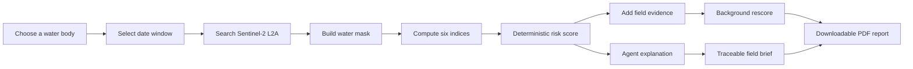
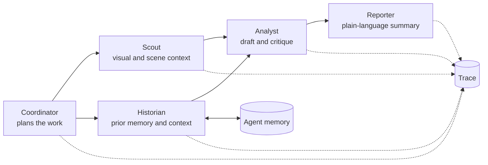

<div align="center">
  

  # AquaLens

  ### Turn satellite signals and field observations into an auditable freshwater monitoring brief.

  <p>
    A full-stack platform for monitoring water bodies with Sentinel-2 imagery,
    deterministic spectral analysis, field evidence, and a traceable agent layer.
  </p>

  <p>
    <a href="#quick-start">Quick start</a> ·
    <a href="#how-it-works">How it works</a> ·
    <a href="docs/user_manual.md">User manual</a> ·
    <a href="docs/architecture.md">Architecture</a> ·
    <a href="docs/api_contract.md">API contract</a>
  </p>
</div>

> **Advisory only.** AquaLens helps teams prioritise sampling locations and interpret environmental signals. It does **not** certify water safety, detect toxins, or replace laboratory testing and professional judgment.

---

## Why AquaLens?

Freshwater monitoring is often split between satellite data, field notes, spreadsheets, and disconnected reports. AquaLens brings those pieces into one repeatable workflow:

- Define a water body by searching for a place, entering coordinates, drawing a polygon, or using a buffered point.
- Retrieve the best available Sentinel-2 L2A scene for the selected area and date window.
- Compute six explainable spectral indices over the water mask.
- Produce a deterministic risk score before any language-model narrative is generated.
- Add observations from the field, including water appearance, odour, algae, rainfall, complaints, dead fish, notes, and photos.
- Keep the full session history, evidence, report, and agent execution trace together.

The result is a monitoring brief that is easier to inspect, compare, share, and act on.

## What makes it different

### Deterministic risk, contextual narrative

AquaLens separates the numeric decision from the explanation. The risk model is a weighted, unit-tested calculation over spectral and field signals. The Gemini-powered layer can explain the result in plain language, but it cannot change the score, risk band, or urgency.

### Satellite analysis that remains inspectable

The platform stores derived index statistics and scene metadata rather than raw GeoTIFFs. Each index includes its value, range, variation, sample count, band inputs, and an interpretation string.

### Evidence-aware monitoring

Remote sensing is complemented by what people can see and report on the ground. New evidence triggers a background rescore, so a session can evolve as observations arrive.

### Traceability by default

Agent plans, sub-agent runs, tool calls, token usage, latency, fallbacks, and failures are persisted when the agentic mode is enabled. Degraded behaviour is visible rather than silent.

---

## How it works



### Monitoring flow

1. Create or select a **water body**. AquaLens stores its geometry, centroid, area, and source.
2. Start a **monitoring session** with a date range and cloud-cover ceiling.
3. The backend searches the configured STAC provider, reads imagery, and analyses the selected polygon.
4. The pipeline calculates six indices over pixels classified as water.
5. The deterministic risk model produces a score, level, urgency, contributors, recommendation, and limitations.
6. If enabled and configured, the agent layer coordinates Scout, Historian, Analyst, and Reporter stages to produce a human-facing explanation and citizen summary.
7. Add **field evidence** whenever new observations become available. The session is rescored in the background.
8. Inspect the complete session or download a regenerated PDF report.

---

## Analysis included

AquaLens calculates six normalised band-math indices from Sentinel-2 L2A surface reflectance:

| Index | Signal | Formula |
| --- | --- | --- |
| **NDWI** | Open-water signal and water mask | `(NIR − SWIR) / (NIR + SWIR)` |
| **MNDWI** | Water signal with reduced built-up confusion | `(Green − SWIR) / (Green + SWIR)` |
| **NDTI** | Turbidity proxy | `(Red − Green) / (Red + Green)` |
| **NDCI** | Chlorophyll-a proxy | `(Red Edge − Red) / (Red Edge + Red)` |
| **NDVI** | Floating biomass and shoreline vegetation stress | `(NIR − Red) / (NIR + Red)` |
| **WRI** | Moisture / open-water ratio | `(Green + Red) / (NIR + SWIR)` |

For every index, the pipeline records masked mean, minimum, maximum, standard deviation, sample count, band provenance, and a plain-language interpretation.

> An elevated chlorophyll proxy is a signal for follow-up—not a toxin measurement or a diagnosis of harmful algal bloom toxicity.

Read the full methodology in [`docs/spectral_indices.md`](docs/spectral_indices.md) and [`docs/risk_model.md`](docs/risk_model.md).

## Risk model

The score is computed in five transparent stages:

1. Normalise NDCI, NDTI, shoreline NDVI, MNDWI, and NDWI signals into bounded ranges.
2. Combine them with fixed weights: NDCI `0.40`, NDTI `0.25`, shoreline NDVI `0.10`, MNDWI floor `0.10`, and NDWI floor `0.15`.
3. Add a bounded field-evidence bonus for signals such as visible algae, suspicious colour or odour, dead fish, complaints, and recent rainfall.
4. Clamp the final score to `[0, 1]`.
5. Bucket it into `low`, `medium`, or `high`, then derive urgency from the risk level and severe field signals.

The language model receives the structured result and is explicitly prevented from inventing measurements, changing the score, changing urgency, or making public-safety guarantees.

---

## Repository map

```text
.
├── backend/                 FastAPI service, pipeline, models, migrations, reports, tests
├── frontend/                Next.js 15 App Router application
├── docs/                    Architecture, API, methodology, agent layer, and user guide
├── infrastructure/          Render and deployment configuration
├── scripts/                 Local development launch scripts
├── assets/                  Brand assets
├── docker-compose.yml        PostGIS + backend + frontend development stack
└── README.md
```

### Technology stack

| Layer | Technologies |
| --- | --- |
| Web app | Next.js 15, React 19, TypeScript, Tailwind CSS, MapLibre GL |
| Data fetching | TanStack Query, typed API client, Zod validation |
| API | FastAPI, Pydantic v2, Uvicorn |
| Persistence | SQLModel / SQLAlchemy, Alembic, SQLite for lightweight local runs, Postgres + PostGIS in the full stack |
| Earth observation | STAC search, Sentinel-2 L2A, Rasterio, NumPy, Shapely, PyProj |
| Agent layer | Gemini API, structured JSON output, tool-enabled stages, optional vector memory |
| Reporting | Jinja2 templates and WeasyPrint PDF generation |
| Quality | Pytest, Ruff, Black, Vitest, TypeScript checks, Playwright |

---

## Quick start

### Prerequisites

- Python **3.11+**
- Node.js **20+**
- pnpm **9**
- Docker and Docker Compose for the PostGIS stack
- A Gemini API key for live narrative generation, or the fake mode for deterministic local runs

### 1. Clone and configure

```bash
git clone https://github.com/RidhimaKulashriz/aqua-lens.git
cd aqua-lens
touch .env
```

Set at least the following values in `.env`:

```dotenv
GOOGLE_API_KEY=your-gemini-api-key
DATABASE_URL=sqlite:///./aqualens.db
CORS_ALLOW_ORIGINS=http://localhost:3000
```

For a key-free local run, use the deterministic fallback:

```dotenv
AQUALENS_FAKE_GEMINI=1
AQUALENS_USE_SAMPLE_PROVIDER=1
```

Never commit API keys or other secrets.

### 2. Start the backend

The convenience script creates or repairs `backend/.venv`, installs dependencies, runs migrations, and starts the API with reload enabled:

```bash
./scripts/run-backend.sh
```

The API is available at:

- REST API: `http://localhost:8000/api/v1`
- Swagger UI: `http://localhost:8000/docs`
- OpenAPI JSON: `http://localhost:8000/openapi.json`
- Health check: `http://localhost:8000/api/v1/health`

### 3. Start the frontend

In a second terminal:

```bash
./scripts/run-frontend.sh
```

Open `http://localhost:3000`.

The frontend defaults to `http://localhost:8000` for the API. Override it when needed:

```bash
NEXT_PUBLIC_API_URL=https://your-api.example.com \
NEXT_PUBLIC_SITE_URL=https://your-app.example.com \
./scripts/run-frontend.sh
```

---

## Run the complete stack with Docker

Docker Compose starts PostGIS, the backend, and the Next.js frontend:

```bash
docker compose up --build
```

| Service | URL / port |
| --- | --- |
| Frontend | `http://localhost:3000` |
| Backend | `http://localhost:8000` |
| Swagger UI | `http://localhost:8000/docs` |
| PostGIS | `localhost:5432` |

The default database credentials in the compose file are intended for local development only. Change them before using a shared or production environment.

Stop the stack while keeping volumes:

```bash
docker compose down
```

Remove the local database, uploads, reports, and Node modules volumes too:

```bash
docker compose down -v
```

---

## Configuration

The backend loads settings from environment variables and the repository-root `.env` file. Important options include:

| Variable | Default | Purpose |
| --- | --- | --- |
| `DATABASE_URL` | `sqlite:///./aqualens.db` | SQLAlchemy database URL. |
| `CORS_ALLOW_ORIGINS` | `http://localhost:3000` | Comma-separated allowed frontend origins. |
| `GOOGLE_API_KEY` | unset | Primary Gemini API key. |
| `GOOGLE_API_KEY_FALLBACK` | unset | Fallback key for quota or rate-limit recovery. |
| `GOOGLE_API_KEY_FALLBACK_2` | unset | Second fallback key. |
| `GEMINI_MODEL` | `gemini-2.0-flash` | Gemini model used by the reasoning service. |
| `GEMINI_EMBEDDING_MODEL` | `text-embedding-004` | Embeddings model for semantic agent memory. |
| `PC_STAC_URL` | Earth Search STAC | STAC endpoint used for satellite scenes. |
| `DEFAULT_LOOKBACK_DAYS` | `30` | Default monitoring lookback window. |
| `MAX_CLOUD_COVER` | `30` | Default maximum scene cloud cover percentage. |
| `AQUALENS_AGENTIC_MODE` | `true` | Enables Coordinator → Scout / Historian / Analyst / Reporter orchestration. |
| `AQUALENS_FAKE_GEMINI` | `false` | Uses deterministic local narrative fallbacks instead of Gemini. |
| `AQUALENS_USE_SAMPLE_PROVIDER` | `false` | Uses sample imagery for tests and demos. |
| `AQUALENS_AGENT_STEP_DELAY_MS` | `0` | Adds visible delay between agent stages for demonstrations. |
| `UPLOAD_DIR` | `data/uploads` | Evidence-photo storage directory. |
| `REPORT_DIR` | `data/reports` | Generated report directory. |

The canonical settings implementation is [`backend/app/core/config.py`](backend/app/core/config.py).

---

## API at a glance

All public endpoints are mounted below `/api/v1`.

### Water bodies

```text
GET    /water-bodies
POST   /water-bodies
GET    /water-bodies/{id}
PATCH  /water-bodies/{id}
DELETE /water-bodies/{id}
POST   /water-bodies/bulk-delete
```

### Monitoring sessions

```text
POST   /sessions
GET    /sessions
GET    /sessions/{id}
GET    /sessions/{id}/indices
GET    /sessions/{id}/risk
GET    /sessions/{id}/trace
GET    /sessions/{id}/report
```

### Field evidence

```text
POST   /sessions/{id}/evidence
GET    /sessions/{id}/evidence
```

Creating a session returns immediately with `status="pending"`; the frontend polls until it becomes `complete` or `failed`. Submitting evidence schedules a background rescore.

Use the live Swagger UI for interactive requests and [`docs/api_contract.md`](docs/api_contract.md) for payloads, response shapes, and error conventions.

---

## Agent layer

When `AQUALENS_AGENTIC_MODE=true` and a Gemini key is available, the narrative workflow is organised into specialised stages:



- **Coordinator** chooses the workflow.
- **Scout** gathers scene and visual context.
- **Historian** recalls and writes water-body-specific observations when memory is available.
- **Analyst** turns structured signals into an evidence-grounded draft and critique.
- **Reporter** produces the citizen-facing summary.

The agent layer is optional. With it disabled—or when fake mode is enabled—the deterministic pipeline still produces a usable result through the fallback narrator and summary paths.

Read the detailed design in [`docs/agent_layer.md`](docs/agent_layer.md) and [`docs/architecture.md`](docs/architecture.md).

---

## Testing and quality checks

### Backend

```bash
cd backend
python -m pytest -q
python -m ruff check .
python -m black --check app/ tests/ alembic/
```

### Frontend

```bash
cd frontend
pnpm typecheck
pnpm lint
pnpm test
pnpm e2e
```

The end-to-end suite expects the application stack to be available. For fast, repeatable backend development, use SQLite with the sample provider and fake Gemini mode.

---

## Deployment

The repository includes deployment configuration for a split deployment:

- **Frontend:** Vercel configuration in [`frontend/vercel.json`](frontend/vercel.json)
- **Backend:** Render blueprint in [`infrastructure/render.yaml`](infrastructure/render.yaml)
- **Database:** Postgres 16 with PostGIS; pgvector is used for semantic agent memory where available

See [`infrastructure/deployment.md`](infrastructure/deployment.md) before deploying. Configure production CORS, database credentials, secret keys, persistent upload/report storage, and the public frontend/API URLs for your environment.

---

## Safety and limitations

AquaLens is designed to make monitoring more consistent—not to make unsupported environmental or public-health claims.

- Satellite indices are proxies and are affected by cloud cover, spatial resolution, atmospheric conditions, mixed pixels, and water-mask quality.
- The risk score is a prioritisation signal, not a regulatory classification or laboratory result.
- LLM-generated prose is constrained by the structured inputs but still requires human review.
- Land or mixed-area classifications skip the agent pipeline and are reported as not-water conditions.
- Uploaded field photos have EXIF metadata stripped before storage, including embedded GPS where present.
- Raw GeoTIFF imagery is not persisted; derived statistics and provider metadata are stored instead.

For the full limitations and methodology, see [`docs/user_manual.md`](docs/user_manual.md), [`docs/spectral_indices.md`](docs/spectral_indices.md), and [`docs/risk_model.md`](docs/risk_model.md).

---

## Documentation

| Document | What it covers |
| --- | --- |
| [`docs/user_manual.md`](docs/user_manual.md) | End-user workflow and interface guide |
| [`docs/architecture.md`](docs/architecture.md) | System design, data flow, and module map |
| [`docs/api_contract.md`](docs/api_contract.md) | REST endpoints and payload contracts |
| [`docs/spectral_indices.md`](docs/spectral_indices.md) | Bands, formulas, masking, and aggregation |
| [`docs/risk_model.md`](docs/risk_model.md) | Deterministic score, evidence bonus, and urgency |
| [`docs/agent_layer.md`](docs/agent_layer.md) | Agent roles, tools, memory, and failure handling |
| [`infrastructure/deployment.md`](infrastructure/deployment.md) | Production deployment walkthrough |

---

## Live deployment

- **Frontend:** [frontend-eight-gamma-82.vercel.app](https://frontend-eight-gamma-82.vercel.app)
- **Backend API:** [aqua-lens-backend.onrender.com](https://aqua-lens-backend.onrender.com)

---

<div align="center">
  <sub>Built for clearer, more explainable freshwater monitoring.</sub>
</div>
