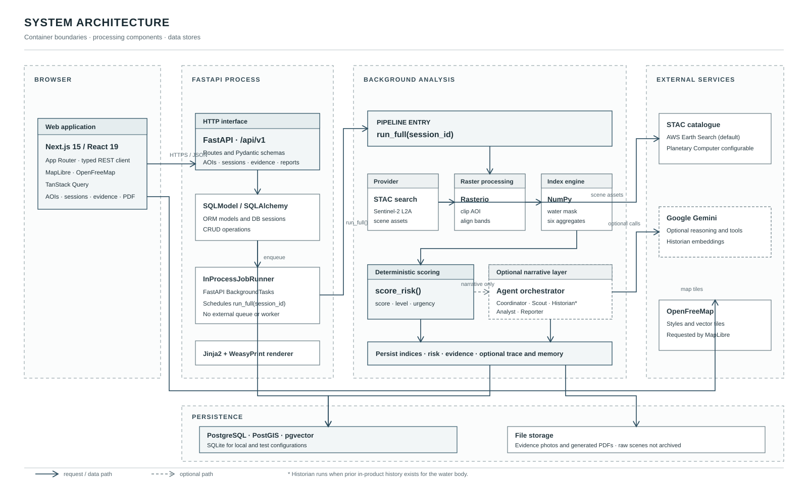
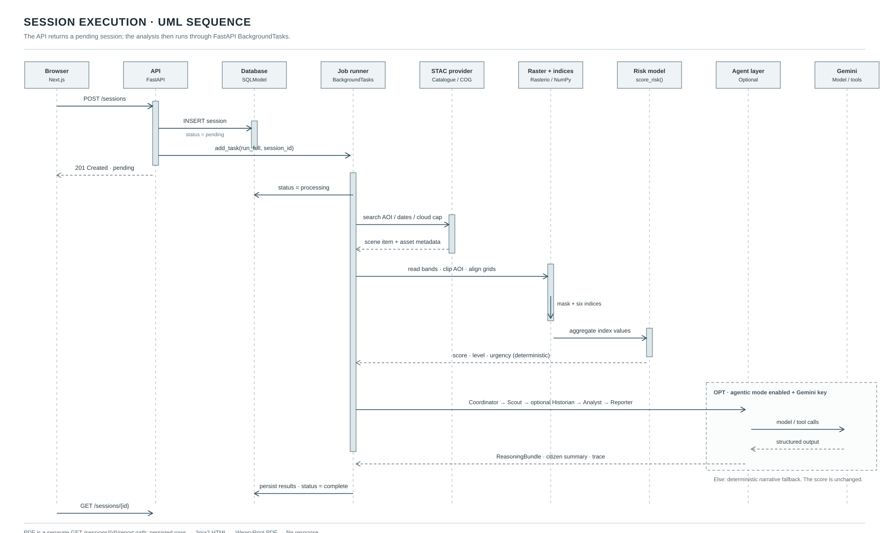
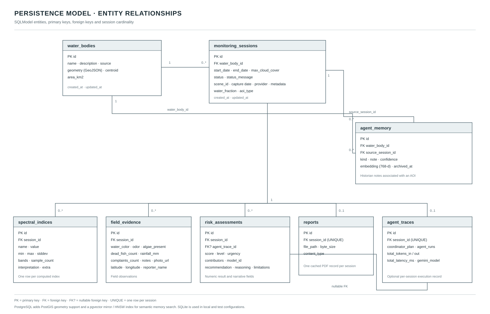

  

  <h1>AquaLens</h1>
  
<strong>Satellite-assisted freshwater monitoring with field evidence and auditable risk scoring.</strong>

  

    <a href="https://frontend-eight-gamma-82.vercel.app">Live application</a> ·
    <a href="https://aqua-lens-backend.onrender.com/docs">API documentation</a> ·
    <a href="docs/user_manual.md">User manual</a> ·
    <a href="docs/architecture.md">Architecture notes</a>
  

  

    
    
    
    
  

> **Advisory system — not a water-quality certification tool.** AquaLens uses satellite-derived proxies and recorded field observations to help organise monitoring and prioritise follow-up. It does not measure toxins, certify water as safe or unsafe, or replace laboratory analysis and qualified environmental assessment.

## Overview

AquaLens is a geospatial monitoring application for lakes, reservoirs, rivers and user-defined areas of interest (AOIs). A monitoring session searches for Sentinel-2 L2A imagery, clips and aligns the required bands, computes six spectral indices, calculates a deterministic risk score, and stores the results with scene metadata.

Field teams can attach observations to a session. An optional Gemini-based agent layer adds historical context and produces explanatory text, while the numeric score remains controlled by the deterministic risk model.

The governing separation is:

- **Measurement:** satellite bands are processed by Rasterio and NumPy.
- **Scoring:** a deterministic Python function calculates score, level and urgency.
- **Explanation:** the optional agent layer writes narrative and a citizen-facing summary. It cannot change the numeric score.

## Product capabilities

| Area | Implementation |
| --- | --- |
| AOI management | Search for a place, enter coordinates, draw a polygon or create a buffered point |
| Scene discovery | STAC search for Sentinel-2 L2A scenes using a date window and cloud-cover limit |
| Raster processing | AOI clipping, reflectance scaling, band alignment and valid-pixel masking |
| Spectral analysis | NDWI, MNDWI, NDTI, NDCI, NDVI and WRI |
| Risk assessment | Weighted deterministic score with a bounded field-evidence adjustment |
| Field reporting | Water colour, odour, algae, dead fish, rainfall, complaints, notes and optional photo |
| Agent trace | Coordinator plan, agent runs, tool calls, token usage, latency and errors |
| Outputs | Session detail, index statistics, risk explanation and on-demand PDF report |

## System design

The diagrams use standard container, sequence and entity-relationship notation. They describe the code and database relationships rather than a conceptual product flow.

### Runtime architecture

  

The backend is a FastAPI application. `POST /api/v1/sessions` creates a pending session and schedules `run_full(session_id)` through FastAPI `BackgroundTasks`. The current `InProcessJobRunner` runs work inside the API process; it is not a Celery, Redis or separate worker deployment.

### Session execution sequence

  

A session is returned before satellite processing finishes. The frontend reads the session detail while its state changes through `pending`, `processing`, `awaiting_evidence`, `complete` or `failed`.

### Persistence model

  

The main records are `water_bodies`, `monitoring_sessions`, `spectral_indices`, `field_evidence`, `risk_assessments`, `reports`, `agent_traces` and `agent_memory`. AOI geometry is stored as GeoJSON; PostgreSQL deployments add PostGIS support and a pgvector index for Historian memory.

## Processing pipeline

1. **Define the AOI.** Store a polygon or buffered point with its centroid, area and source.
2. **Create a session.** Select a date range and maximum cloud cover. The API returns the session with `pending` status.
3. **Discover imagery.** Query the configured STAC endpoint for Sentinel-2 L2A imagery and retrieve the required assets.
4. **Prepare the raster.** Clip to the AOI, scale surface-reflectance values by 10,000 and align bands to a common grid.
5. **Build the water mask.** A pixel is included when it is valid and both NDWI and MNDWI are finite and above zero.
6. **Compute indices.** Calculate the six indices and aggregate mean, minimum, maximum, standard deviation and sample count.
7. **Score and explain.** Run the deterministic risk model; then run the optional agent layer or the deterministic narrative fallback.
8. **Persist and report.** Store the session outputs. A PDF is rendered when the report endpoint is requested.

### Imagery source and fallback behaviour

The configured STAC endpoint is controlled by `PC_STAC_URL`. Its default is AWS Earth Search:

~~~text
https://earth-search.aws.element84.com/v1
~~~

The provider can be configured to use Microsoft Planetary Computer. The pipeline also has a deterministic `SampleProvider` for tests and offline runs. **If the live imagery provider raises an error, the current pipeline falls back to sample imagery.** Check the stored `scene_provider` and scene metadata before treating a session as satellite-derived; sample output is synthetic and is not an observation of the selected water body.

Raw GeoTIFF scenes are not archived by the application. The pipeline stores derived index values and scene metadata.

## Spectral analysis

The implementation uses Sentinel-2 surface-reflectance bands:

| Index | Formula | Bands | Intended signal |
| --- | --- | --- | --- |
| **NDWI** | `(B08 - B11) / (B08 + B11)` | NIR, SWIR | Open-water signal |
| **MNDWI** | `(B03 - B11) / (B03 + B11)` | Green, SWIR | Water signal with reduced built-up confusion |
| **NDTI** | `(B04 - B03) / (B04 + B03)` | Red, Green | Turbidity / suspended sediment proxy |
| **NDCI** | `(B05 - B04) / (B05 + B04)` | Red Edge, Red | Chlorophyll-a proxy |
| **NDVI** | `(B08 - B04) / (B08 + B04)` | NIR, Red | Vegetation / floating biomass signal |
| **WRI** | `(B03 + B04) / (B08 + B11)` | Green, Red, NIR, SWIR | Water and moisture ratio |

The water mask is the intersection of the valid-pixel mask, `NDWI > 0` and `MNDWI > 0`. This combined condition reduces false positives that can occur when vegetation produces a positive NDWI signal.

If the water mask contains no pixels, the index aggregator falls back to all finite pixels in the AOI so that it can still return statistics. In that case, the values are not water-only measurements. Use `water_fraction` and `aoi_type` alongside the index values:

| Water fraction | AOI classification |
| ---: | --- |
| `≥ 0.50` | `water` |
| `≥ 0.20` and `< 0.50` | `mixed` |
| `< 0.20` | `land` |

See [`docs/spectral_indices.md`](docs/spectral_indices.md) for band details and implementation notes.

## Deterministic risk model

The base score is a weighted sum of five normalised contributors. The weights sum to 1.0.

| Contributor | Weight | Normalisation |
| --- | ---: | --- |
| NDCI | 0.40 | `[-0.1, 0.5]` |
| NDTI | 0.25 | `[-0.2, 0.6]` |
| NDVI | 0.10 | `[0.0, 0.6]` |
| MNDWI water-signal floor | 0.10 | `1 - normalize(MNDWI, 0, 0.5)` |
| NDWI water-signal floor | 0.15 | `1 - normalize(NDWI, 0, 0.5)` |

~~~python
base_score = (
    0.40 * normalize(NDCI, -0.1, 0.5)
  + 0.25 * normalize(NDTI, -0.2, 0.6)
  + 0.10 * normalize(NDVI,  0.0, 0.6)
  + 0.10 * (1 - normalize(MNDWI, 0.0, 0.5))
  + 0.15 * (1 - normalize(NDWI,  0.0, 0.5))
)

final_score = clamp(base_score + evidence_bonus, 0.0, 1.0)
~~~

The latest field-evidence record contributes a bounded bonus:

| Observation | Contribution | Per-factor cap |
| --- | ---: | ---: |
| Algae present | +0.20 | — |
| Suspicious colour | +0.10 | — |
| Suspicious odour | +0.10 | — |
| Dead fish | +0.05 per fish | 0.20 |
| Public complaints | +0.04 per complaint | 0.12 |
| Rainfall | +0.03 per 10 mm | 0.10 |

The combined evidence bonus is capped at `0.50`. The final score is clamped to `[0, 1]`.

| Score | Risk level |
| ---: | --- |
| `< 0.33` | Low |
| `0.33 – < 0.66` | Medium |
| `≥ 0.66` | High |

Urgency is calculated separately. A severe field signal is algae present, at least five dead fish, or at least three complaints. A high score with a severe signal is `immediate`; a high score without one is `elevated`. Medium and low scores become `elevated` when a severe signal is present and otherwise remain `routine`.

The numeric model is implemented in [`backend/app/services/risk_model.py`](backend/app/services/risk_model.py). Gemini does not calculate or override the score, risk level or urgency.

More detail: [`docs/risk_model.md`](docs/risk_model.md).

## Optional agent layer

The agent layer runs after the deterministic analysis. It is enabled by `AQUALENS_AGENTIC_MODE` and requires a configured Gemini API key.

| Agent | Responsibility |
| --- | --- |
| Coordinator | Selects the execution plan and stage budgets |
| Scout | Adds scene-level context to the analysis |
| Historian | Retrieves prior in-product history and water-body memory when available |
| Analyst | Produces and critiques the reasoning bundle |
| Reporter | Produces a structured citizen-facing summary |

The pipeline's satellite retrieval and numerical computation remain the source of the measurements. Agent output is used for narrative context and reporting; it does not modify the already-computed risk score.

### Trace and memory

- `agent_traces` stores the Coordinator plan, per-agent runs, tool calls, inputs/outputs, token counts, latency and errors.
- `agent_memory` stores distilled notes linked to a water body and source session.
- Memory embeddings are 768-dimensional and use `text-embedding-004`. PostgreSQL deployments add a pgvector column and HNSW index.
- The Historian is skipped when there is no prior in-product history for that water body.

### Failure handling

Agent failures have deterministic fallbacks. Coordinator errors use a default plan; Historian errors omit historical context; Analyst errors use the deterministic reasoning bundle; Reporter errors use the deterministic citizen summary. If the agent layer fails as a whole, the pipeline uses the single-call reasoning path.

See [`docs/agent_layer.md`](docs/agent_layer.md).

## API

All routes are under `/api/v1`. Interactive OpenAPI documentation is available at [`/docs`](https://aqua-lens-backend.onrender.com/docs).

| Method | Endpoint | Purpose |
| --- | --- | --- |
| GET | `/health` | Health check |
| GET / POST | `/water-bodies` | List or create AOIs |
| GET / PATCH / DELETE | `/water-bodies/{id}` | Read, update or delete an AOI |
| POST | `/water-bodies/bulk-delete` | Delete multiple AOIs |
| GET / POST | `/sessions` | List sessions or create a monitoring run |
| GET | `/sessions/{id}` | Read session details and persisted results |
| GET | `/sessions/{id}/indices` | Read spectral-index aggregates |
| GET | `/sessions/{id}/risk` | Read risk assessment |
| GET | `/sessions/{id}/trace` | Read agent trace when present |
| GET | `/sessions/{id}/field-brief` | Legacy field-brief payload, when present |
| GET / POST | `/sessions/{id}/evidence` | List or submit field evidence |
| GET | `/sessions/{id}/report` | Render and download a PDF |

Evidence submission accepts multipart form data, with an optional `photo` file. Supported image formats are JPEG, PNG and WebP; the image is validated and re-saved with EXIF metadata stripped before storage.

The report endpoint renders the PDF from persisted session data on each request using Jinja2 and WeasyPrint. It does not simply serve a previously generated report indefinitely.

Full request and response shapes: [`docs/api_contract.md`](docs/api_contract.md).

## Repository layout

~~~text
aqua-lens/
├── backend/
│   ├── app/
│   │   ├── api/v1/           # FastAPI routes
│   │   ├── core/             # settings, database, task runner, logging
│   │   ├── models/           # SQLModel persistence entities
│   │   ├── schemas/          # request and response models
│   │   ├── services/
│   │   │   ├── agent/        # Coordinator, Scout, Historian, Analyst, Reporter
│   │   │   ├── satellite/    # STAC providers and sample provider
│   │   │   ├── indices.py
│   │   │   ├── risk_model.py
│   │   │   ├── pipeline.py
│   │   │   └── report_generator.py
│   │   └── utils/
│   ├── alembic/              # database migrations
│   ├── tests/
│   └── pyproject.toml
├── frontend/
│   ├── app/                  # marketing and monitoring routes
│   ├── components/           # map, session, evidence, report and UI
│   ├── hooks/
│   └── lib/                  # API client, types and utilities
├── docs/                     # architecture, API, science, agent and user docs
├── infrastructure/           # deployment configuration
├── scripts/
├── assets/                   # logo and README diagrams
└── docker-compose.yml
~~~

## Run locally

### Requirements

- Python 3.11+
- Node.js 20+
- pnpm 9+
- Docker Desktop (recommended when running the PostGIS configuration)

### Option A — Docker

From the repository root:

~~~bash
docker compose up --build
~~~

This starts the PostGIS database, backend API and frontend. Check `docker-compose.yml` for the configured ports and environment.

### Option B — Run the services separately

Create a root-level `.env` file. The following settings select the offline sample imagery provider and deterministic narrative path:

~~~dotenv
DATABASE_URL=sqlite:///./aqualens.db
AQUALENS_USE_SAMPLE_PROVIDER=true
AQUALENS_FAKE_GEMINI=true
~~~

> The sample provider generates synthetic imagery. It is useful for UI, API and pipeline development, but its results must not be presented as observations of a real water body.

**Backend — Windows PowerShell**

~~~powershell
cd backend
py -3.11 -m venv .venv
.\.venv\Scripts\Activate.ps1
python -m pip install --upgrade pip
pip install -e ".[dev]"
alembic upgrade head
uvicorn app.main:app --reload --host 127.0.0.1 --port 8000
~~~

**Backend — macOS / Linux**

~~~bash
./scripts/run-backend.sh
~~~

**Frontend**

In a second terminal:

~~~bash
cd frontend
corepack pnpm install
corepack pnpm dev
~~~

Open the frontend at `http://localhost:3000`. The API is at `http://localhost:8000`, with Swagger UI at `http://localhost:8000/docs`.

To use live STAC imagery, set `AQUALENS_USE_SAMPLE_PROVIDER=false` (the default) and configure `PC_STAC_URL` when needed. To enable the multi-agent layer, configure `GOOGLE_API_KEY` and set `AQUALENS_AGENTIC_MODE=true`.

## Configuration

| Variable | Default | Description |
| --- | --- | --- |
| `DATABASE_URL` | `sqlite:///./aqualens.db` | SQLAlchemy connection URL |
| `PC_STAC_URL` | AWS Earth Search STAC | STAC API root |
| `DEFAULT_LOOKBACK_DAYS` | `30` | Default monitoring window |
| `MAX_CLOUD_COVER` | `30` | Default scene cloud-cover limit |
| `GOOGLE_API_KEY` | unset | Gemini API key |
| `GOOGLE_API_KEY_FALLBACK` | unset | Optional quota fallback key |
| `GOOGLE_API_KEY_FALLBACK_2` | unset | Second optional quota fallback |
| `GEMINI_MODEL` | `gemini-2.0-flash` | Gemini model used by the reasoning layer |
| `GEMINI_EMBEDDING_MODEL` | `text-embedding-004` | Historian embedding model |
| `AQUALENS_AGENTIC_MODE` | `true` | Enable the multi-agent layer |
| `AQUALENS_FAKE_GEMINI` | `false` | Use deterministic fake reasoning in tests/offline runs |
| `AQUALENS_USE_SAMPLE_PROVIDER` | `false` | Force synthetic sample imagery |
| `AQUALENS_AGENT_STEP_DELAY_MS` | `0` | Optional delay between visible agent stages |
| `UPLOAD_DIR` | `data/uploads` | Evidence photo directory |
| `REPORT_DIR` | `data/reports` | Generated PDF directory |

Set secrets through environment variables or a local `.env` file. Do not commit API keys.

## Tests and quality checks

**Backend**

~~~bash
cd backend
python -m pytest -q
ruff check app tests
black --check app tests
~~~

**Frontend**

~~~bash
cd frontend
corepack pnpm typecheck
corepack pnpm test
corepack pnpm e2e
corepack pnpm build
~~~

The frontend also defines a `lint` script in `package.json`.

## Deployment

The current hosted environment uses:

| Component | Hosted service |
| --- | --- |
| Frontend | [Vercel](https://frontend-eight-gamma-82.vercel.app) |
| FastAPI backend | [Render](https://aqua-lens-backend.onrender.com) |
| PostgreSQL | Supabase PostgreSQL with PostGIS and pgvector |
| Satellite catalogue | Configured STAC endpoint |
| Map tiles | OpenFreeMap |
| Narrative and embeddings | Google Gemini |

Deployment configuration is in [`infrastructure/deployment.md`](infrastructure/deployment.md).

**Operational notes**

- Render's free service filesystem is ephemeral. Uploaded field photos can disappear after a restart unless a persistent disk or external object store is configured.
- PDFs are regenerated from database records when requested, so the report can be rebuilt after a filesystem reset.
- The current background runner uses FastAPI `BackgroundTasks` inside the API process. It is not a durable distributed queue; a process restart can interrupt an active run.
- The API currently does not implement user authentication or authorization. Do not treat a public deployment as a private, user-isolated workspace.

## Limitations

- Sentinel-2 indices are indirect spectral proxies. NDCI is not a direct chlorophyll laboratory measurement; none of the indices identifies a toxin.
- Cloud, haze, shadows, mixed pixels, seasonal variation, water depth and shoreline contamination can affect the values.
- A mixed or land-dominated AOI may not be suitable for water-quality interpretation. Check `water_fraction` and `aoi_type`.
- If live imagery retrieval fails, the pipeline can return synthetic sample-provider output. Verify `scene_provider` and metadata before using a result.
- Field evidence is user-submitted and is not independently verified by the application.
- Risk values are prioritisation signals, not regulatory thresholds or a substitute for sampling and laboratory testing.

## Documentation

| Document | Contents |
| --- | --- |
| [`docs/user_manual.md`](docs/user_manual.md) | Product workflow and user instructions |
| [`docs/architecture.md`](docs/architecture.md) | Backend, frontend and processing architecture |
| [`docs/api_contract.md`](docs/api_contract.md) | API paths, payloads, responses and errors |
| [`docs/spectral_indices.md`](docs/spectral_indices.md) | Sentinel-2 bands, formulas and aggregation |
| [`docs/risk_model.md`](docs/risk_model.md) | Normalisation, weights, evidence adjustment and urgency |
| [`docs/agent_layer.md`](docs/agent_layer.md) | Agents, memory, traces and fallbacks |
| [`docs/frontend_design.md`](docs/frontend_design.md) | Frontend structure and design system |
| [`infrastructure/deployment.md`](infrastructure/deployment.md) | Hosted deployment instructions |

---

  AquaLens · Satellite observations, field evidence and deterministic analysis

