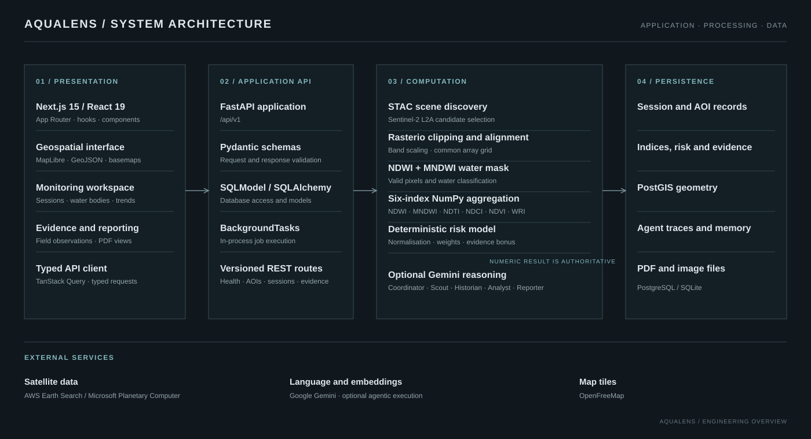
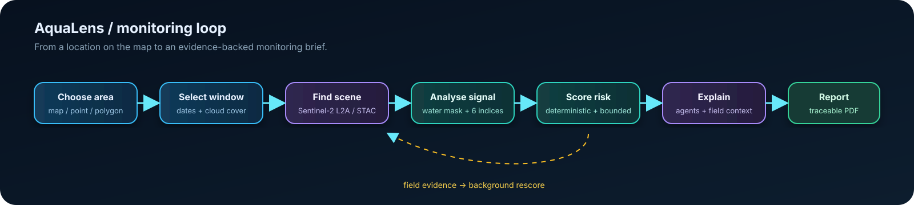
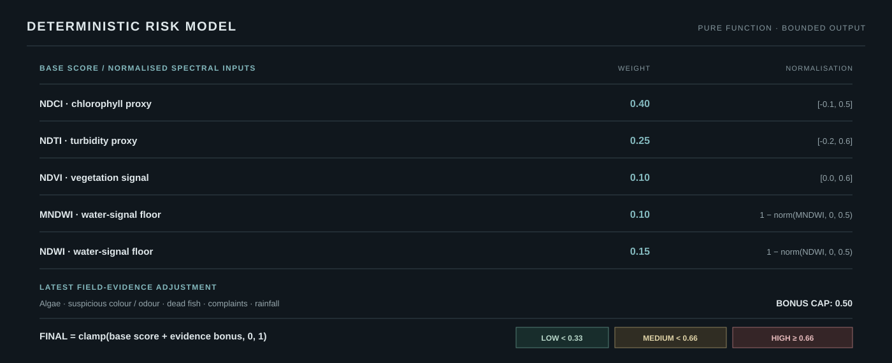

<div align="center">
  

  <h1>AquaLens</h1>
  <p><strong>Autonomous freshwater monitoring with a deterministic core and a traceable agent layer.</strong></p>

  <p>
    <a href="https://frontend-eight-gamma-82.vercel.app">Live app</a> ·
    <a href="https://aqua-lens-backend.onrender.com/docs">API explorer</a> ·
    <a href="docs/user_manual.md">User manual</a> ·
    <a href="docs/architecture.md">Deep architecture</a>
  </p>

  <p>
    
    
    
    
  </p>
</div>

> **Advisory only.** AquaLens helps teams prioritise sampling locations and interpret environmental signals. It does not certify water safety, detect toxins, or replace laboratory testing and professional judgment.

## Navigate this README

<details open>
<summary><strong>Open the project map</strong></summary>

- [What AquaLens is](#what-aqualens-is)
- [Interactive architecture](#interactive-architecture)
- [Product workflow](#product-workflow)
- [Science and risk model](#science-and-risk-model)
- [Agent layer](#agent-layer)
- [Complete repository inventory](#complete-repository-inventory)
- [Frontend map](#frontend-map)
- [Backend map](#backend-map)
- [API surface](#api-surface)
- [Run locally](#run-locally)
- [Configuration](#configuration)
- [Testing](#testing)
- [Deployment](#deployment)
- [Limitations](#limitations)
- [Documentation](#documentation)

</details>

## What AquaLens is

AquaLens is a full-stack freshwater monitoring system. It connects a water-body map, satellite imagery, spectral analysis, field evidence, deterministic risk scoring, agent-assisted explanation, and PDF reporting into one traceable session.

The core product idea is intentionally simple:

> **The deterministic pipeline decides what the numbers say. The agent layer explains what they mean.**

A monitoring team can:

| Need | AquaLens surface |
| --- | --- |
| Define an area | Search a place, paste coordinates, draw a polygon, or create a buffered point |
| Find imagery | Search Sentinel-2 L2A scenes through STAC with a date and cloud-cover window |
| Measure change | Compute six spectral indices over a water mask |
| Prioritise action | Combine satellite signals and field evidence into a bounded risk score |
| Add local context | Record colour, odour, algae, dead fish, rain, complaints, notes, and photos |
| Explain the result | Generate a field brief and citizen summary with the optional agent layer |
| Share the work | Inspect traces and download a regenerated PDF report |

## System architecture

The visuals below are stored in the repository as dark SVGs so they remain readable on GitHub dark mode and do not depend on a white canvas.

### System architecture

<p align="center">
  
</p>

<details>
<summary><strong>Expand the architecture by layer</strong></summary>

| Layer | What is inside | Repository location |
| --- | --- | --- |
| Presentation | Marketing pages, dashboard, monitor, sessions, water bodies, settings, reports | `frontend/app/` |
| UI system | Navigation, map, session cards, evidence forms, report controls, shadcn-style primitives | `frontend/components/` |
| API | FastAPI application, versioned routes, request validation, OpenAPI | `backend/app/api/`, `backend/app/schemas/` |
| Runtime | Settings, database, logging, background jobs, startup maintenance | `backend/app/core/`, `backend/app/main.py` |
| Science | STAC providers, raster reads, water masks, six indices, risk model | `backend/app/services/satellite/`, `indices.py`, `risk_model.py` |
| Reasoning | Coordinator, Scout, Historian, Analyst, Reporter, trace recorder, fallbacks | `backend/app/services/agent/` |
| Persistence | Water bodies, sessions, indices, risk, evidence, reports, traces, memory | `backend/app/models/`, `backend/alembic/` |
| Delivery | PDF templates, uploads, generated reports, Vercel, Render, Supabase | `backend/app/services/templates/`, `infrastructure/` |

</details>

### Data flow

<p align="center">
  
</p>

### Deterministic risk path

<p align="center">
  
</p>

## Product workflow

### 1. Define a water body

The frontend supports place search, coordinate entry, map selection, polygon drawing, and buffered points. The backend stores the geometry, centroid, calculated area, and source.

### 2. Start a monitoring session

A session accepts a water body, date range, and maximum cloud-cover threshold. It is created immediately and processed in the background:

```text
pending  →  processing  →  complete
                         ↘  failed
```

### 3. Analyse the satellite scene

The pipeline searches the configured STAC provider, reads the required Sentinel-2 bands, builds a water mask, and aggregates the six indices over the selected area.

### 4. Calculate risk

A deterministic weighted model combines satellite signals. Field evidence can add a bounded bonus. The resulting score is clamped to `[0, 1]` and converted to a risk level and urgency.

### 5. Add field evidence

The evidence form supports:

| Evidence | Stored by AquaLens |
| --- | --- |
| Visual observations | Water colour, odour, algae presence |
| Incident signals | Dead fish, public complaints, recent rainfall |
| Human context | Notes, reporter name, latitude, longitude |
| Media | Optional photo upload with EXIF metadata stripped before storage |

Submitting evidence schedules a background rescore of the session.

### 6. Explain and report

When enabled, the agent layer writes the narrative, citizen summary, citations, and execution trace. The report generator turns the persisted session into a PDF and includes the advisory disclaimer.

## Science and risk model

### Spectral indices

| Index | Primary signal | Sentinel-2 bands |
| --- | --- | --- |
| **NDWI** | Open-water signal and water mask | NIR, SWIR |
| **MNDWI** | Water signal with reduced built-up confusion | Green, SWIR |
| **NDTI** | Turbidity / suspended sediment proxy | Red, Green |
| **NDCI** | Chlorophyll-a proxy | Red Edge, Red |
| **NDVI** | Floating biomass and shoreline stress | NIR, Red |
| **WRI** | Moisture and open-water ratio | Green, Red, NIR, SWIR |

<details>
<summary><strong>Expand the formulas</strong></summary>

```text
NDWI  = (NIR - SWIR) / (NIR + SWIR)
MNDWI = (Green - SWIR) / (Green + SWIR)
NDTI  = (Red - Green) / (Red + Green)
NDCI  = (Red Edge - Red) / (Red Edge + Red)
NDVI  = (NIR - Red) / (NIR + Red)
WRI   = (Green + Red) / (NIR + SWIR)
```

Bands are resampled to a common grid. The pipeline masks the selected polygon, drops invalid and non-water pixels, and stores mean, minimum, maximum, standard deviation, sample count, band provenance, and interpretation.

See [`docs/spectral_indices.md`](docs/spectral_indices.md).

</details>

### Risk weights

| Contributor | Weight | Interpretation |
| --- | ---: | --- |
| NDCI chlorophyll proxy | `0.40` | Primary biological-signal contributor |
| NDTI turbidity proxy | `0.25` | Suspended-sediment / turbidity contribution |
| Shoreline NDVI | `0.10` | Vegetation and shoreline-stress contribution |
| MNDWI water-signal floor | `0.10` | Confidence penalty when water signal is weak |
| NDWI water-signal floor | `0.15` | Confidence penalty when water mask signal is weak |

Field evidence adds a bounded bonus for algae, suspicious colour or odour, dead fish, complaints, and rainfall. The score is bucketed as:

| Final score | Level | Typical urgency |
| ---: | --- | --- |
| `< 0.33` | Low | Routine |
| `0.33 – 0.65` | Medium | Routine or elevated |
| `≥ 0.66` | High | Elevated or immediate |

See [`docs/risk_model.md`](docs/risk_model.md).

## Agent layer

The agent layer is optional and feature-flagged. It sits above the deterministic pipeline; it does not replace it.

| Stage | Responsibility | Implementation |
| --- | --- | --- |
| **Coordinator** | Plans which stages run and sets budgets | `backend/app/services/agent/orchestrator.py` |
| **Scout** | Searches scenes, inspects metadata, uses vision on thumbnails | `backend/app/services/agent/scout.py` |
| **Historian** | Reads session history, trends, citations, and persistent memory | `backend/app/services/agent/historian.py` |
| **Analyst** | Drafts, critiques, and optionally rewrites the reasoning bundle | `backend/app/services/agent/analyst.py` |
| **Reporter** | Produces the structured citizen-facing summary | `backend/app/services/agent/reporter.py` |

### Trace and memory

| Store | Purpose |
| --- | --- |
| `agent_traces` | Coordinator plan, agent runs, tool calls, token counts, latency, errors |
| `agent_memory` | Water-body-specific historian notes with semantic embeddings |

If an agent fails, AquaLens falls back instead of silently losing the session:

| Failure | Fallback |
| --- | --- |
| Coordinator error | Default Scout → Analyst → Reporter plan |
| Historian error | Analyst continues without historical context |
| Analyst error | Deterministic reasoning bundle |
| Reporter error | Deterministic citizen summary |
| Whole agent-layer error | Single-call deterministic-safe reasoning path |

Full details: [`docs/agent_layer.md`](docs/agent_layer.md).

## Complete repository inventory

This is the project map for the actual repository—not a generic stack diagram.

<details open>
<summary><strong>Root and operations</strong></summary>

| Path | Role |
| --- | --- |
| `README.md` | This project hub |
| `docker-compose.yml` | Local PostGIS, backend, and frontend orchestration |
| `scripts/run-backend.sh` | Creates the backend environment, migrates, starts Uvicorn |
| `scripts/run-frontend.sh` | Installs frontend dependencies and starts Next.js |
| `scripts/run-docker.sh` | Docker convenience entry point |
| `assets/` | Brand and README architecture visuals |
| `infrastructure/` | Render and deployment instructions |
| `.gitignore` | Python, Node, local data, logs, and IDE exclusions |

</details>

<details>
<summary><strong>Backend inventory</strong></summary>

| Area | Files / modules | Responsibility |
| --- | --- | --- |
| Entry point | `backend/app/main.py` | FastAPI app, lifespan, migrations, static uploads |
| API router | `backend/app/api/v1/router.py` | Versioned route registration |
| Core runtime | `backend/app/core/config.py` | Environment-backed settings |
|  | `backend/app/core/database.py` | SQLAlchemy / SQLModel engine and sessions |
|  | `backend/app/core/tasks.py` | Background job runner protocol and implementation |
|  | `backend/app/core/logging.py` | Application logging |
| Models | `backend/app/models/` | Water bodies, sessions, indices, risk, evidence, reports, traces, memory |
| Schemas | `backend/app/schemas/` | Pydantic request and response DTOs |
| Main pipeline | `backend/app/services/pipeline.py` | End-to-end monitoring orchestration |
| Satellite | `backend/app/services/satellite/` | Provider interface, Planetary Computer, offline sample provider |
| Indices | `backend/app/services/indices.py` | NumPy spectral calculations and aggregation |
| Risk | `backend/app/services/risk_model.py` | Weighted deterministic score and urgency |
| Reasoning | `backend/app/services/reasoning.py` | Structured narrative fallback / single-call path |
| Agents | `backend/app/services/agent/` | Coordinator, Scout, Historian, Analyst, Reporter, runtime, traces |
| Evidence | `backend/app/services/evidence_handler.py` | Photo validation and EXIF stripping |
| Reports | `backend/app/services/report_generator.py` | Jinja2 + WeasyPrint PDF generation |
| Citizen summary | `backend/app/services/citizen_summary.py` | Stable public-facing fallback summary |
| Utilities | `backend/app/utils/` | Geography, location, charts, PDF helpers |
| Templates | `backend/app/services/templates/` | Branded HTML report template and assets |
| Migrations | `backend/alembic/versions/` | Database schema history |
| Tests | `backend/tests/` | API, pipeline, science, agents, migrations, PDF, and model coverage |

</details>

<details>
<summary><strong>Frontend inventory</strong></summary>

### Routes

| Surface | Route files |
| --- | --- |
| Marketing | `frontend/app/(marketing)/page.tsx`, `about/page.tsx`, `methodology/page.tsx`, `limitations/page.tsx`, `changelog/page.tsx` |
| Dashboard | `frontend/app/(app)/dashboard/page.tsx` |
| Monitoring | `frontend/app/(app)/monitor/page.tsx` |
| Sessions | `frontend/app/(app)/sessions/page.tsx`, `[id]/page.tsx`, `[id]/evidence/page.tsx`, `[id]/report/page.tsx` |
| Water bodies | `frontend/app/(app)/water-bodies/page.tsx`, `[id]/page.tsx` |
| Settings | `frontend/app/(app)/settings/page.tsx` |
| Platform | `layout.tsx`, `error.tsx`, `not-found.tsx`, `robots.ts`, `sitemap.ts` |

### Components

| Component group | What it contains |
| --- | --- |
| `components/chrome/` | Sidebar, top navigation, footer, command menu, logo, theme toggle |
| `components/map/` | MapLibre map, map search, mini-map, basemap switcher |
| `components/session/` | Session wizard, risk cards, index tables, trace, scene metadata, status UI |
| `components/evidence/` | Evidence form and evidence list |
| `components/report/` | PDF report download button |
| `components/water-body/` | Water-body actions |
| `components/marketing/` | Hero, workflow, agent constellation, indices showcase, citations, CTA |
| `components/motion/` | Number animation, fade-in, staggered motion |
| `components/ui/` | Badge, button, card, dialog, drawer, dropdown, input, progress, tabs, tooltip, and other primitives |
| `hooks/` | Sessions, water bodies, evidence, geocoding, agent trace |
| `lib/` | API client, types, query keys, geography, formatting, SEO, glossary, environment |
| `public/map-styles/` | Street, satellite, and terrain MapLibre styles |

</details>

<details>
<summary><strong>Documentation and infrastructure inventory</strong></summary>

| Path | Covers |
| --- | --- |
| `docs/architecture.md` | Backend, frontend, pipeline, agent topology, data guarantees |
| `docs/frontend_design.md` | Frontend information architecture and visual system |
| `docs/api_contract.md` | REST payloads, responses, errors, and lifecycle |
| `docs/spectral_indices.md` | Sentinel-2 bands, formulas, masking, aggregation |
| `docs/risk_model.md` | Risk normalisation, weights, evidence bonus, urgency |
| `docs/agent_layer.md` | Agent tools, memory, traces, fallbacks, tests |
| `docs/user_manual.md` | End-user workflow |
| `infrastructure/deployment.md` | Supabase + Render + Vercel deployment |
| `infrastructure/render.yaml` | Render blueprint |
| `frontend/vercel.json` | Frontend deployment configuration |
| `backend/Dockerfile` | Backend image and WeasyPrint runtime dependencies |
| `backend/pyproject.toml` | Python package, dependencies, tests, Ruff, Black |
| `frontend/package.json` | Frontend dependencies and scripts |

</details>

## Frontend map

The Next.js application is split into two product surfaces:

<table>
  <tr>
    <td width="50%"><strong>Marketing surface</strong><br /><br />Landing page<br />Methodology<br />Limitations<br />About<br />Changelog<br /><br /><code>frontend/app/(marketing)/</code></td>
    <td width="50%"><strong>Monitoring application</strong><br /><br />Dashboard<br />Map-based monitor<br />Water bodies<br />Session history<br />Evidence capture<br />Risk and index analysis<br />Agent trace<br />PDF report<br /><br /><code>frontend/app/(app)/</code></td>
  </tr>
</table>

The UI uses MapLibre for geography, TanStack Query for server state, typed API helpers, shadcn-style primitives, and motion components for progressive disclosure.

## Backend map

The backend is intentionally layered:

```text
FastAPI routes
    ↓
Pydantic schemas
    ↓
Background task runner
    ↓
Monitoring pipeline
    ├── Satellite provider
    ├── Spectral indices
    ├── Deterministic risk model
    ├── Optional agent layer
    ├── Evidence handler
    └── PDF report generator
    ↓
SQLModel / Postgres / PostGIS / pgvector
```

The numeric pipeline completes before the narrative layer. The agent layer can enrich the explanation, but the risk model remains authoritative.

## API surface

All public routes are mounted under `/api/v1`.

| Area | Method | Endpoint | Purpose |
| --- | --- | --- | --- |
| Health | `GET` | `/health` | Liveness check |
| Water bodies | `GET` | `/water-bodies` | List saved areas |
| Water bodies | `POST` | `/water-bodies` | Create a polygon or buffered point |
| Water bodies | `GET` | `/water-bodies/{id}` | Read one area |
| Water bodies | `PATCH` | `/water-bodies/{id}` | Rename or update description |
| Water bodies | `DELETE` | `/water-bodies/{id}` | Delete an area and child sessions |
| Sessions | `POST` | `/sessions` | Create a background monitoring run |
| Sessions | `GET` | `/sessions` | List and filter sessions |
| Sessions | `GET` | `/sessions/{id}` | Read complete session detail |
| Analysis | `GET` | `/sessions/{id}/indices` | Read six spectral indices |
| Analysis | `GET` | `/sessions/{id}/risk` | Read risk, urgency, contributors, reasoning |
| Evidence | `POST` | `/sessions/{id}/evidence` | Add field evidence and optional photo |
| Evidence | `GET` | `/sessions/{id}/evidence` | List field evidence |
| Trace | `GET` | `/sessions/{id}/trace` | Read multi-agent execution trace |
| Report | `GET` | `/sessions/{id}/report` | Download a regenerated PDF |

Full payloads and response schemas: [`docs/api_contract.md`](docs/api_contract.md).

## Run locally

### Requirements

- Python 3.11+
- Node.js 20+
- pnpm 9+
- Docker Desktop for PostGIS mode

### Local deterministic mode

```bash
git clone https://github.com/RidhimaKulashriz/aqua-lens.git
cd aqua-lens
cat > .env <<'EOF'
AQUALENS_FAKE_GEMINI=1
AQUALENS_USE_SAMPLE_PROVIDER=1
DATABASE_URL=sqlite:///./aqualens.db
CORS_ALLOW_ORIGINS=http://localhost:3000
EOF
```

Terminal 1 — backend:

```bash
./scripts/run-backend.sh
```

Terminal 2 — frontend:

```bash
./scripts/run-frontend.sh
```

Open:

| Surface | URL |
| --- | --- |
| Frontend | `http://localhost:3000` |
| API | `http://localhost:8000/api/v1` |
| Swagger | `http://localhost:8000/docs` |
| OpenAPI | `http://localhost:8000/openapi.json` |
| Health | `http://localhost:8000/api/v1/health` |

### Live Gemini mode

Replace the fake-mode settings with your own key:

```dotenv
GOOGLE_API_KEY=your-gemini-api-key
DATABASE_URL=sqlite:///./aqualens.db
CORS_ALLOW_ORIGINS=http://localhost:3000
```

Never commit `.env` or API keys.

### Docker mode

```bash
docker compose up --build
```

This starts PostGIS on `5432`, the backend on `8000`, and the frontend on `3000`.

## Configuration

| Variable | Default | Used by |
| --- | --- | --- |
| `DATABASE_URL` | `sqlite:///./aqualens.db` | Database layer |
| `CORS_ALLOW_ORIGINS` | `http://localhost:3000` | API CORS |
| `GOOGLE_API_KEY` | unset | Gemini runtime |
| `GOOGLE_API_KEY_FALLBACK` | unset | Quota fallback |
| `GOOGLE_API_KEY_FALLBACK_2` | unset | Second quota fallback |
| `GEMINI_MODEL` | `gemini-2.0-flash` | Narrative generation |
| `GEMINI_EMBEDDING_MODEL` | `text-embedding-004` | Historian memory |
| `PC_STAC_URL` | Earth Search STAC | Satellite provider |
| `DEFAULT_LOOKBACK_DAYS` | `30` | New-session default |
| `MAX_CLOUD_COVER` | `30` | Scene filter |
| `AQUALENS_AGENTIC_MODE` | `true` | Multi-agent orchestration |
| `AQUALENS_FAKE_GEMINI` | `false` | Deterministic local fallback |
| `AQUALENS_USE_SAMPLE_PROVIDER` | `false` | Sample imagery provider |
| `AQUALENS_AGENT_STEP_DELAY_MS` | `0` | Demo pacing |
| `UPLOAD_DIR` | `data/uploads` | Evidence photos |
| `REPORT_DIR` | `data/reports` | Generated PDFs |

Canonical implementation: [`backend/app/core/config.py`](backend/app/core/config.py).

## Testing

### Backend

```bash
cd backend
python -m pytest -q
python -m ruff check .
python -m black --check app/ tests/ alembic/
```

### Frontend

```bash
cd frontend
pnpm typecheck
pnpm lint
pnpm test
pnpm e2e
```

| Test area | Location |
| --- | --- |
| Agent runtime and tools | `backend/tests/test_agent_runtime.py`, `test_agent_tools.py` |
| Agent stages | `backend/tests/test_agent_scout.py`, `test_agent_historian.py`, `test_agent_analyst.py`, `test_agent_orchestrator.py` |
| Pipeline and risk | `backend/tests/test_pipeline.py`, `test_risk_model.py`, `test_indices.py` |
| API | `backend/tests/test_api_sessions.py`, `test_api_evidence.py` |
| Reports | `backend/tests/test_pdf.py` |
| Frontend units | `frontend/tests/unit/` |
| Frontend E2E | `frontend/tests/e2e/landing.spec.ts` |

## Deployment

The repository is structured for a split deployment:

| Surface | Provider | Configuration |
| --- | --- | --- |
| Frontend | Vercel | `frontend/vercel.json` |
| Backend | Render Docker service | `infrastructure/render.yaml` |
| Database | Supabase Postgres + PostGIS + pgvector | `infrastructure/deployment.md` |
| Satellite imagery | Microsoft Planetary Computer STAC | Backend environment |
| Map tiles | OpenFreeMap | Frontend map styles |
| LLM reasoning | Google AI Studio Gemini | `GOOGLE_API_KEY` |

Deployment guide: [`infrastructure/deployment.md`](infrastructure/deployment.md).

## Limitations

AquaLens works with environmental signals and proxies. Results can be affected by cloud cover, scene availability, atmospheric conditions, spatial resolution, mixed pixels, water-mask quality, and incomplete field observations.

Use AquaLens to decide **what deserves a closer look**. Use laboratory testing and qualified professionals to decide **what is safe**.

## Documentation

| Document | Purpose |
| --- | --- |
| [`docs/architecture.md`](docs/architecture.md) | Deep backend, frontend, pipeline, and data architecture |
| [`docs/frontend_design.md`](docs/frontend_design.md) | Frontend information architecture and visual system |
| [`docs/api_contract.md`](docs/api_contract.md) | API payloads, responses, lifecycle, and errors |
| [`docs/spectral_indices.md`](docs/spectral_indices.md) | Sentinel-2 bands, formulas, masking, and aggregation |
| [`docs/risk_model.md`](docs/risk_model.md) | Normalisation, weights, evidence bonus, and urgency |
| [`docs/agent_layer.md`](docs/agent_layer.md) | Agent roles, tools, memory, traces, and fallbacks |
| [`docs/user_manual.md`](docs/user_manual.md) | End-user workflow |
| [`infrastructure/deployment.md`](infrastructure/deployment.md) | Supabase, Render, Vercel, and production notes |

---

<div align="center">
  <p><strong>Observe clearly. Investigate sooner. Keep the reasoning visible.</strong></p>
  <sub>AquaLens · freshwater monitoring infrastructure</sub>
</div>
