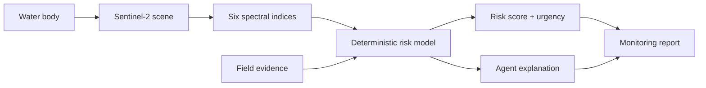

<div align="center">
  

  <p><strong>Satellite intelligence for clearer freshwater decisions.</strong></p>

  <p>
    AquaLens combines Sentinel-2 imagery, field observations, deterministic risk scoring,
    and an explainable agent workflow in one monitoring workspace.
  </p>

  <p>
    <a href="https://frontend-eight-gamma-82.vercel.app">Live app</a> ·
    <a href="https://aqua-lens-backend.onrender.com/docs">API docs</a> ·
    <a href="docs/user_manual.md">User guide</a> ·
    <a href="docs/architecture.md">Architecture</a>
  </p>
</div>

<br />

> **AquaLens is advisory software.** It helps teams prioritise follow-up sampling. It does not certify water safety, detect toxins, or replace laboratory testing.

## The idea

Freshwater monitoring should not require stitching together satellite scenes, field notes, spreadsheets, and reports by hand.

AquaLens turns a water body into a repeatable monitoring session:

```text
Choose a water body  →  Read the satellite signal  →  Add field evidence  →  Explain the result  →  Share the report
```

The number is calculated deterministically. The narrative explains it. The evidence stays attached to the session.

## What AquaLens does

<table>
  <tr>
    <td width="50%"><strong>Remote sensing</strong><br />Finds a suitable Sentinel-2 L2A scene and analyses the selected water area.</td>
    <td width="50%"><strong>Six water indices</strong><br />Computes NDWI, MNDWI, NDTI, NDCI, NDVI, and WRI over the water mask.</td>
  </tr>
  <tr>
    <td><strong>Explainable risk</strong><br />Produces a bounded score, risk level, urgency, contributors, and limitations.</td>
    <td><strong>Field evidence</strong><br />Adds colour, odour, algae, rainfall, complaints, dead fish, notes, and photos.</td>
  </tr>
  <tr>
    <td><strong>Agent workflow</strong><br />Coordinates Scout, Historian, Analyst, and Reporter stages when enabled.</td>
    <td><strong>Traceable reports</strong><br />Keeps session history, agent traces, evidence, and a downloadable PDF together.</td>
  </tr>
</table>

## The principle that matters

### The model can explain the score. It cannot change the score.

AquaLens calculates its numeric risk assessment before the language-model layer runs. Gemini receives the structured measurements and context, then produces a human-readable explanation. It is not allowed to invent measurements or move the risk band.

That separation makes the system easier to test, audit, and trust:



## Built for real monitoring workflows

1. **Create an area** — search for a place, enter coordinates, draw a polygon, or use a buffered point.
2. **Start a session** — choose the date window and cloud-cover limit.
3. **Inspect the signal** — review the selected scene and six derived indices.
4. **Add what the field team sees** — observations and photos become part of the assessment.
5. **Review and share** — follow the risk reasoning, inspect the trace, and download a PDF brief.

## Technology

| Frontend | Backend | Earth observation | Storage & reports |
| --- | --- | --- | --- |
| Next.js 15<br />React 19<br />TypeScript<br />MapLibre GL | FastAPI<br />Python 3.11+<br />SQLModel<br />Background tasks | Sentinel-2 L2A<br />STAC<br />Rasterio<br />NumPy | SQLite or Postgres/PostGIS<br />Alembic<br />Jinja2<br />WeasyPrint |

## Run it locally

### Requirements

- Python 3.11+
- Node.js 20+
- pnpm 9+
- Docker Desktop, if you want the full PostGIS stack

### Fast local setup

```bash
git clone https://github.com/RidhimaKulashriz/aqua-lens.git
cd aqua-lens
printf 'AQUALENS_FAKE_GEMINI=1\nAQUALENS_USE_SAMPLE_PROVIDER=1\n' > .env
```

In terminal one:

```bash
./scripts/run-backend.sh
```

In terminal two:

```bash
./scripts/run-frontend.sh
```

Then open **[http://localhost:3000](http://localhost:3000)**.

The backend is available at **[http://localhost:8000](http://localhost:8000)**. Interactive API documentation lives at **[http://localhost:8000/docs](http://localhost:8000/docs)**.

### Live Gemini + satellite data

Replace the local `.env` contents with your own configuration:

```dotenv
GOOGLE_API_KEY=your-gemini-api-key
DATABASE_URL=sqlite:///./aqualens.db
CORS_ALLOW_ORIGINS=http://localhost:3000
```

For the complete Postgres/PostGIS environment:

```bash
docker compose up --build
```

This starts the frontend on `3000`, the API on `8000`, and PostGIS on `5432`.

## API surface

The public API is mounted under `/api/v1`:

```text
GET/POST       /water-bodies
GET/PATCH/DELETE /water-bodies/{id}
POST           /sessions
GET            /sessions
GET            /sessions/{id}
GET            /sessions/{id}/indices
GET            /sessions/{id}/risk
POST/GET       /sessions/{id}/evidence
GET            /sessions/{id}/trace
GET            /sessions/{id}/report
GET            /health
```

A new session starts in the background and moves from `pending` to `processing` to `complete` or `failed`. Adding field evidence schedules a rescore.

## Documentation

| Read this | When you want to… |
| --- | --- |
| [`docs/user_manual.md`](docs/user_manual.md) | Use the product end to end |
| [`docs/architecture.md`](docs/architecture.md) | Understand the system and data flow |
| [`docs/api_contract.md`](docs/api_contract.md) | Build against the REST API |
| [`docs/spectral_indices.md`](docs/spectral_indices.md) | Review the formulas and satellite bands |
| [`docs/risk_model.md`](docs/risk_model.md) | Audit the score and urgency logic |
| [`docs/agent_layer.md`](docs/agent_layer.md) | Understand the agent roles and memory |
| [`infrastructure/deployment.md`](infrastructure/deployment.md) | Deploy the application |

## Quality checks

```bash
# Backend
cd backend
python -m pytest -q
python -m ruff check .
python -m black --check app/ tests/ alembic/

# Frontend
cd ../frontend
pnpm typecheck
pnpm lint
pnpm test
```

## Limitations

AquaLens works with environmental signals, not certainty. Results can be affected by cloud cover, spatial resolution, atmospheric conditions, mixed pixels, water-mask quality, and incomplete field observations. A high or low score is a prioritisation signal—not a laboratory result or public-health certification.

---

<div align="center">
  <sub>Observe better. Investigate sooner. Keep the reasoning visible.</sub>
</div>
